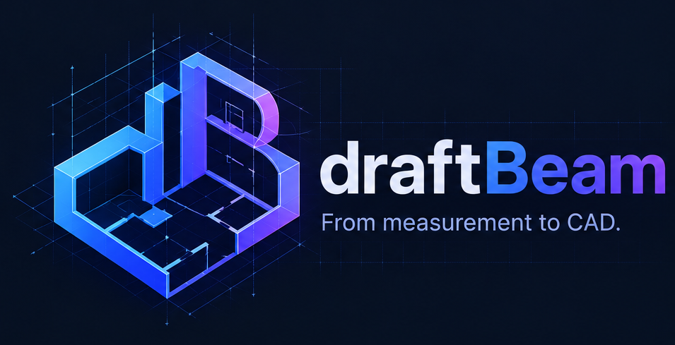
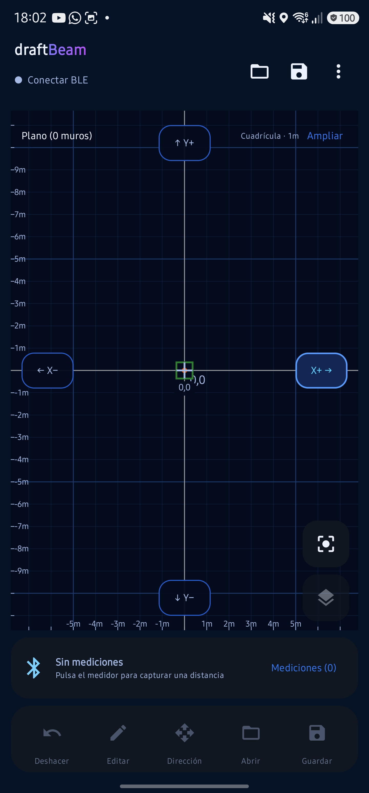
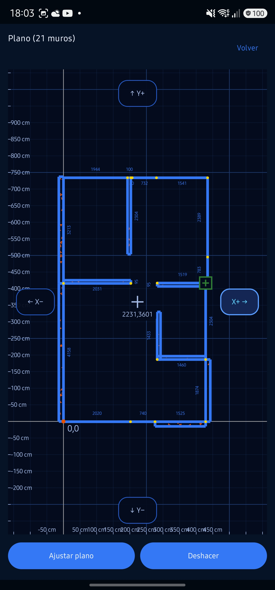
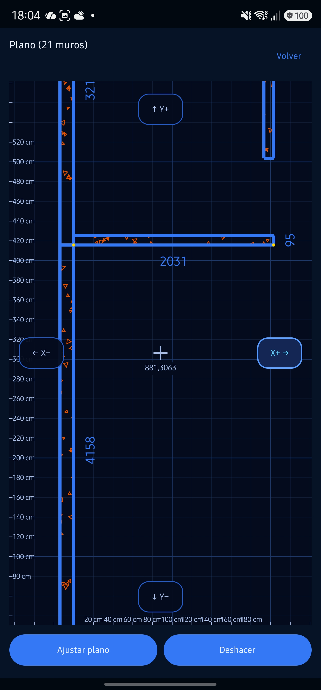

# draftBeam



draftBeam es una aplicación **Android de código abierto** para capturar medidas de un telémetro láser por Bluetooth Low Energy (BLE), dibujar un plano sencillo de muros y guardarlo como DXF editable. Está en etapa de prototipo: no necesita cuenta ni servidor y aún tiene funciones pendientes de validar en dispositivos reales.


## Qué puedes hacer

- Conectar un telémetro compatible por BLE y convertir sus lecturas de metros a milímetros. El dispositivo probado se identifica como `M130` (Milessey M120 Pro); otros modelos no están verificados.
- Crear muros a partir de lecturas, elegir dirección `X+`, `X−`, `Y+` o `Y−`, o dibujar segmentos aproximados con el dedo. Editar longitud, ancho y lado de crecimiento de cada muro.
- Seleccionar extremos existentes, acercar/alejar y desplazar el plano; ver una lupa y optar por conectar extremos cercanos al terminar un trazo.
- Deshacer cambios geométricos y abrir el plano a pantalla completa.
- Guardar y abrir archivos DXF locales mediante el selector de documentos de Android. La exportación usa milímetros y entidades estándar para líneas, contornos de muros, hatch y cotas.

> **Alcance DXF:** no es un editor CAD general. La importación admite las entidades compatibles implementadas; puede omitir arcos, bloques, splines y otras entidades avanzadas. Guarda una copia del DXF original antes de editarlo.


## Requisitos y compatibilidad

| Requisito | Detalle |
| --- | --- |
| Android | **7.0 (API 24) o superior**, según `minSdk` en `android/app/build.gradle.kts` |
| Hardware | Bluetooth Low Energy; la aplicación declara BLE como obligatorio |
| Telémetro | Protocolo observado en Milessey M120 Pro / `M130`; no se garantiza compatibilidad con otros modelos |
| Permisos | Bluetooth y, en Android 11 o anterior, ubicación para buscar dispositivos BLE; se solicitan según la versión de Android |

La configuración de compilación usa `targetSdk 37` y `compileSdk 37`. **Android 7.0 es el mínimo configurado, no una certificación de funcionamiento en todas las versiones o equipos**. Se recomienda probar con un teléfono y un medidor reales; un emulador no valida la conexión BLE.


## Primeros pasos

1. Abre `android/` en Android Studio, instala el SDK de Android requerido por el proyecto y sincroniza Gradle.
2. Ejecuta la configuración `app` en un dispositivo Android con BLE, o compila desde la terminal:

   ```sh
   cd android
   ./gradlew assembleDebug
   ```

   El APK de depuración se genera en `android/app/build/outputs/apk/debug/app-debug.apk`.
3. Concede los permisos solicitados por Android. Usa **Conectar BLE** para buscar y elegir el medidor; el nombre se muestra como conectado cuando termina la suscripción a las mediciones.
4. Selecciona una dirección y mide, o arrastra desde un extremo del plano para trazar un muro. Usa **Guardar DXF** para elegir dónde guardar el archivo; **Abrir DXF** reemplaza el plano actual tras confirmación.

Si solo quieres explorar el editor, puedes dibujar con el dedo sin conectar un medidor. Las líneas trazadas así tienen longitud aproximada: ajusta el valor numéricamente antes de exportar si necesitas precisión.


## Capturas de pantalla

<table>
  <tr>
    <td width="50%"></td>
    <td width="50%"></td>
  </tr>
  <tr>
    <td width="50%"></td>
    <td width="50%"></td>
  </tr>
  <tr>
   <td width="50%"></td>
   <td width="50%"></td>
  </tr>
</table>


## Tecnología y estructura

- **Kotlin + Jetpack Compose / Material 3** para la interfaz Android; tema oscuro Tokyo Night + Blueprint CAD.
- **Android Bluetooth GATT** para BLE. Se observan notificaciones de la característica `0xFFB2` del servicio `0xFFB0`; el formato de las lecturas está documentado solo para las muestras verificadas. No se envían comandos BLE desconocidos.
- **Geometría local en milímetros:** segmentos, ancho de muros, viewport con zoom y exportación/importación DXF. No hay backend ni sincronización en la nube.
- **Gradle Wrapper** en `android/`, con versiones de plugins y bibliotecas en `android/gradle/libs.versions.toml`.
- Código principal: `android/app/src/main/java/cl/fernandocuevas/draftbeam/` (`MainActivity.kt`, `PlanPreview.kt`, `PlanGeometry.kt`, `MeasurementParser.kt` y `DxfCodec.kt`).

Para ejecutar pruebas unitarias, compilar el APK de depuración y comprobar lint:

```sh
cd android
./gradlew testDebugUnitTest assembleDebug lintDebug
```


## Estado y limitaciones

- El plano se mantiene en memoria mientras la aplicación está abierta. **No existe aún un formato nativo de proyectos**: guarda un DXF para conservar el trabajo entre sesiones.
- La conexión y el formato BLE se han investigado con el dispositivo indicado; todavía faltan pruebas completas de esta versión de la interfaz con el medidor y más muestras del protocolo.
- La exportación/importación DXF tiene pruebas automatizadas, pero conviene verificar visualmente los archivos resultantes en tu programa CAD.
- Algunos controles visibles son elementos de interfaz deshabilitados hasta que se implementen sus funciones.

Consulta [`CONTEXT.md`](CONTEXT.md) para conocer el alcance y las decisiones técnicas en detalle. No publiques APKs propietarios, identificadores BLE ni registros que contengan datos personales.


## Licencia

draftBeam se distribuye como software de código abierto bajo la [licencia MIT](LICENSE). Puedes usar, modificar y redistribuir el código conforme a esa licencia; no cubre software, marcas ni recursos de terceros ajenos a este repositorio.
